

<picture><source media="(prefers-color-scheme: dark)" srcset="assets/hero-dark.svg"></picture>

<picture><source media="(prefers-color-scheme: dark)" srcset="assets/social-l-dark.svg"></picture><a href="https://discord.com/879393496627306587"><picture><source media="(prefers-color-scheme: dark)" srcset="assets/social-1-dark.svg"></picture></a><a href="https://x.com/"><picture><source media="(prefers-color-scheme: dark)" srcset="assets/social-2-dark.svg"></picture></a><a href="https://kmmiio99o.dev"><picture><source media="(prefers-color-scheme: dark)" srcset="assets/social-3-dark.svg"></picture></a><picture><source media="(prefers-color-scheme: dark)" srcset="assets/social-r-dark.svg"></picture>

<picture><source media="(prefers-color-scheme: dark)" srcset="assets/about-dark.svg"></picture>

<picture><source media="(prefers-color-scheme: dark)" srcset="assets/stack-dark.svg"></picture>

<a href="https://github.com/kmmiio99o/ShiggyCord"><picture><source media="(prefers-color-scheme: dark)" srcset="assets/project-shiggycord-dark.svg"></picture></a>&nbsp;<a href="https://github.com/kmmiio99o/ShiggyXposed"><picture><source media="(prefers-color-scheme: dark)" srcset="assets/project-shiggyxposed-dark.svg"></picture></a>

<a href="https://github.com/kmmiio99o/ShiggyManager"><picture><source media="(prefers-color-scheme: dark)" srcset="assets/project-shiggymanager-dark.svg"></picture></a>&nbsp;<a href="https://github.com/kmmiio99o/kmmiio99o.github.io"><picture><source media="(prefers-color-scheme: dark)" srcset="assets/project-kmmiio99o-github-io-dark.svg"></picture></a>

<picture><source media="(prefers-color-scheme: dark)" srcset="assets/stats-dark.svg"></picture>

<picture><source media="(prefers-color-scheme: dark)" srcset="assets/streak-dark.svg"></picture>

<picture><source media="(prefers-color-scheme: dark)" srcset="assets/wave-dark.svg"></picture>

<picture><source media="(prefers-color-scheme: dark)" srcset="assets/button-l-dark.svg"></picture><a href="https://kmmiio99o.dev"><picture><source media="(prefers-color-scheme: dark)" srcset="assets/button-1-dark.svg"></picture></a><a href="https://github.com/kmmiio99o?tab=repositories"><picture><source media="(prefers-color-scheme: dark)" srcset="assets/button-2-dark.svg"></picture></a><picture><source media="(prefers-color-scheme: dark)" srcset="assets/button-r-dark.svg"></picture>

<a href="https://metawka.github.io/expressive-profile/?from=kmmiio99o"><picture><source media="(prefers-color-scheme: dark)" srcset="assets/credit-dark.svg"></picture></a>

